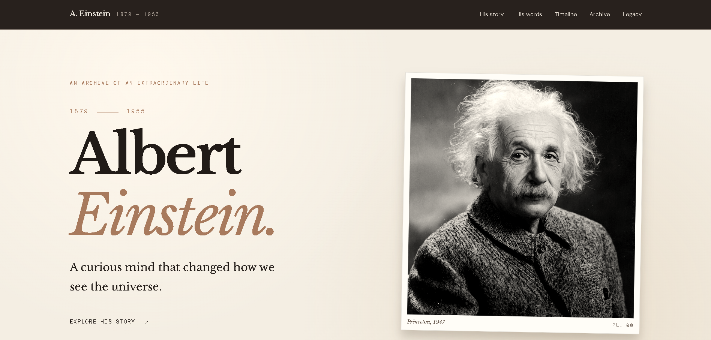
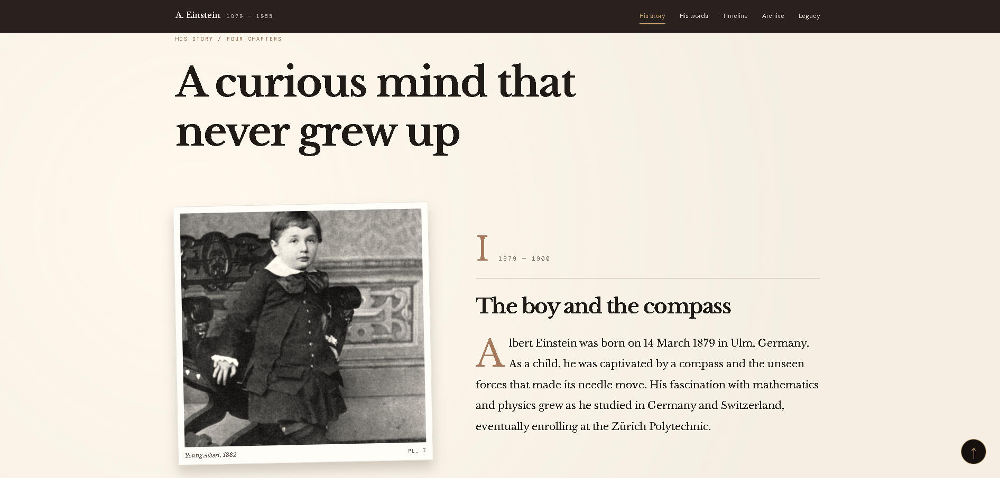
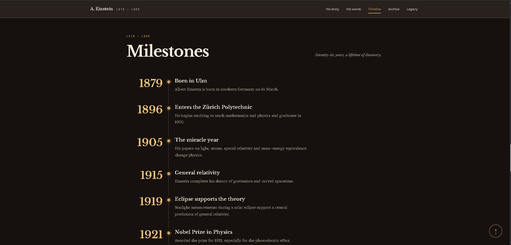
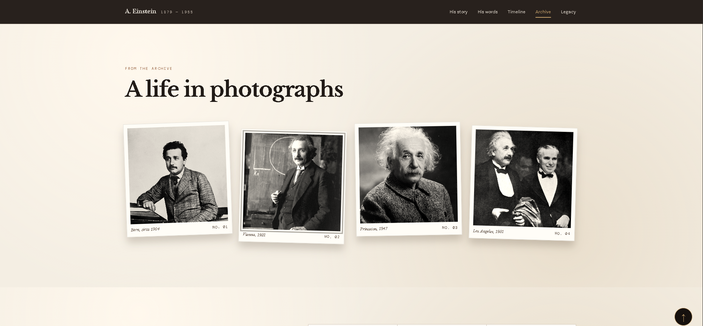
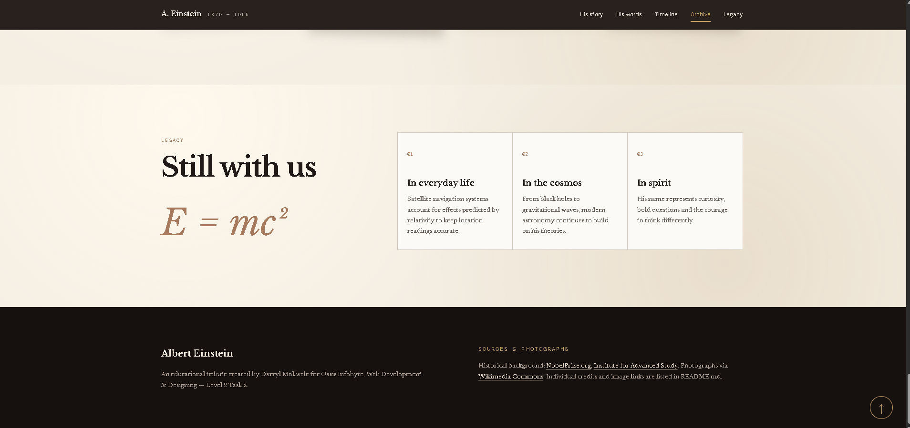

# Albert Einstein — Tribute Page

## 📌 Project Overview

This project is a responsive and interactive tribute website dedicated to **Albert Einstein**, one of the most influential theoretical physicists in history.

It was developed as part of my **OASIS INFOBYTE Web Development & Designing Internship — Level 2, Task 2**.

The website presents Einstein's biography, major scientific discoveries, historical photographs, achievements and lasting legacy.

The design is inspired by a vintage historical documentary, featuring warm cream backgrounds, dark sections, elegant typography, gold accents and archival-style photographs.

## ✨ Features

### 1. Responsive Navigation
- Navigation links to different website sections.
- Smooth scrolling between sections.
- Active navigation highlighting.
- Sticky navigation bar.

### 2. Biography Section
- Detailed biography of Albert Einstein.
- Four chapters covering different periods of his life.
- Historical photographs alongside text.
- Vintage photograph frames.
- Responsive two-column layouts.

### 3. Historical Quotations
- Dedicated quotation section.
- Large, elegant typography.
- Historical photograph background.
- Dark overlay for improved readability.

### 4. Interactive Timeline
- Chronological milestones from 1879 to 1955.
- Major scientific discoveries and achievements.
- Animated timeline highlighting.
- Responsive layout for smaller screens.

### 5. Historical Photo Archive
- Vintage Polaroid-style photograph gallery.
- Historical images with descriptive captions.
- Clickable photographs.
- Full-screen image viewer.
- Previous and Next navigation.
- Keyboard navigation using arrow keys.
- Escape key to close the viewer.

### 6. Scroll Animations
- Smooth content reveal effects.
- Animated biography chapters.
- Subtle transitions for photographs.
- Intersection Observer API for efficient animations.

### 7. Back-to-Top Button
- Appears when users scroll down.
- Smoothly returns visitors to the top.
- Automatically hides near the beginning.

### 8. Legacy Section
- Einstein's contributions to modern science.
- Information about relativity and gravity.
- His influence on technology and scientific research.
- Display of the famous equation E = mc².

## 🛠️ Technologies Used

| Technology | Purpose |
|------------|---------|
| HTML5 | Website structure and semantic elements |
| CSS3 | Styling, layouts and responsiveness |
| JavaScript | Interactive website functionality |
| CSS Grid | Responsive content and gallery layouts |
| Flexbox | Navigation and element alignment |
| Intersection Observer API | Scroll animations and timeline effects |
| Google Fonts | Vintage typography |
| VS Code | Development environment |
| Git & GitHub | Version control |

**Note:** The website uses custom CSS and vanilla JavaScript. No Bootstrap, Tailwind CSS, jQuery or other frontend frameworks were used.

## 📁 Project Structure

```text
WebDev-L2-TributePage/
│
├── index.html
├── style.css
├── script.js
├── README.md
│
│
└── screenshots/
    ├── tribute-home.png
    ├── tribute-biography.png
    ├── tribute-timeline.png
    ├── tribute-gallery.png
    └── tribute-legacy.png
```

Some historical photographs may be loaded from Wikimedia Commons rather than stored locally.

## 🚀 How to Run the Project

### Option 1 — Open in a Browser

1. Download or clone the OIBSIP repository.
2. Navigate to `WebDev-L2-TributePage`.
3. Open `index.html` in a web browser.
4. Explore the website using the navigation menu.

### Option 2 — Visual Studio Code

1. Open the project in VS Code.
2. Install the Live Server extension.
3. Right-click `index.html`.
4. Select **Open with Live Server**.
5. The website opens in your default browser.

No additional packages or build tools are required.

An internet connection may be needed to load Google Fonts and Wikimedia Commons images.

## 📸 Screenshots

### Home Page



### Biography



### Historical Timeline



### Photo Archive



### Legacy Section



## 🎮 User Interactions

| Action | Result |
|--------|--------|
| Click navigation link | Scrolls to selected section |
| Scroll through biography | Content fades into view |
| Click a historical photo | Opens full-screen image viewer |
| Click Next/Previous | Changes gallery photograph |
| Press Left/Right Arrow | Navigates gallery photographs |
| Press Escape | Closes the photograph viewer |
| Scroll through timeline | Highlights milestones |
| Click back-to-top | Returns to the top of the page |

## 📱 Responsive Design

The website is designed to support:

- Desktop computers
- Laptops
- Tablets
- Smartphones

CSS media queries adjust the navigation, typography, image gallery, biography chapters and timeline to fit different screen sizes.

## ♿ Accessibility

The website includes:

- Semantic HTML elements.
- Descriptive image alternative text.
- Keyboard-accessible image viewing.
- Visible focus indicators.
- Reduced-motion support.
- Responsive and readable typography.
- Accessible navigation labels.

## 🧪 Testing

The following functionality should be verified before submission:

| Test Case | Expected Result |
|-----------|-----------------|
| Navigation links | Open correct sections |
| Historical images | Display correctly |
| Image lightbox | Opens and closes |
| Gallery arrows | Change photographs |
| Keyboard navigation | Works correctly |
| Scroll animations | Reveal content smoothly |
| Timeline | Highlights visible events |
| Back-to-top | Returns to page beginning |
| Mobile layout | No unwanted overflow |
| External references | Open valid sources |

## 📚 Learning Outcomes

Through this project, I developed and improved my understanding of:

- Semantic HTML5.
- Custom CSS styling without frameworks.
- Responsive web development.
- CSS Grid and Flexbox.
- JavaScript DOM manipulation.
- Event listeners and user interactions.
- Intersection Observer API.
- Creating image galleries.
- Accessible and responsive design.
- Git and GitHub version control.
- Website documentation.

## 📖 References and Image Credits

Historical and biographical information was researched using:

- [Nobel Prize — Albert Einstein](https://www.nobelprize.org/prizes/physics/1921/einstein/facts/)
- [Institute for Advanced Study](https://www.ias.edu/scholars/einstein)
- [Encyclopaedia Britannica — Albert Einstein](https://www.britannica.com/biography/Albert-Einstein)
- [Wikimedia Commons](https://commons.wikimedia.org/wiki/Category:Albert_Einstein)

Historical photographs are credited to their respective sources.

Image licensing and attribution requirements should be checked on the individual Wikimedia Commons file pages.

## 🏢 Internship Information

**Organisation:** OASIS INFOBYTE  
**Track:** Web Development & Designing  
**Level:** 2  
**Task:** 2 — Tribute Page  
**Project:** Albert Einstein Tribute Page  
**Status:** Completed

## 👨‍💻 Developer

**Darryl Mokwele**

Bachelor of Computing Student

Interested in Software Engineering, Web Development and modern technologies.

